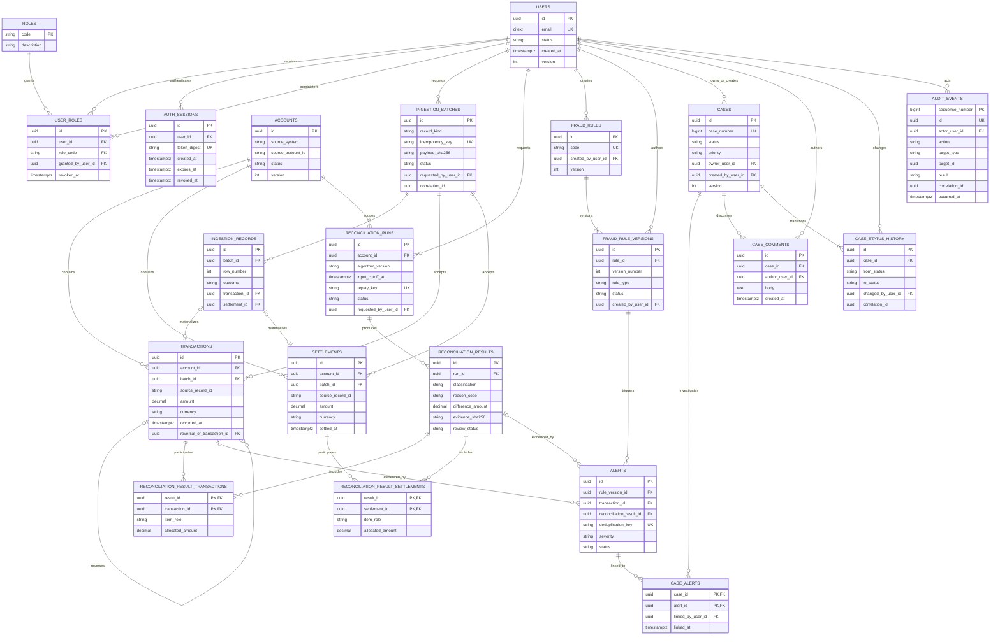

# Entity-Relationship Diagram

This logical ER diagram shows ownership and evidence flow. Column-level types, constraints, lifecycle rules, and indexes are defined in [the data model](DATA_MODEL.md).

## Relationship notes

- The two reconciliation item tables avoid unenforceable polymorphic foreign keys and support multiple matched or candidate facts per result.
- `ingestion_records` links to at most one materialised fact. Invalid/duplicate/conflicting rows keep their evidence without creating a financial fact.
- Rule versions, alerts, reconciliation results, comments, history, and audit events retain immutable evidence. Mutable aggregate summaries use optimistic concurrency.
- `audit_events.target_type/target_id` is intentionally a logical reference: a single audit table can cover authentication attempts that have no target row and future entities without a polymorphic database foreign key.
- The diagram omits repeated actor and reviewer relationships for readability; the detailed model remains authoritative.
