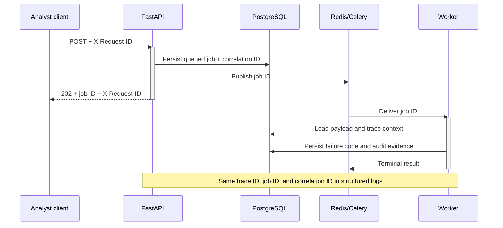

# Observability contract

## Purpose

LedgerGuard must make an important API-to-worker failure diagnosable from telemetry without
attaching a debugger or querying opaque application internals. This contract covers Day 15's
structured logs, correlation, metrics, traces, health signals, dashboard, and failure drill. It
does not claim production alert thresholds, SLOs, or measured capacity; those require Day 17
performance evidence and the Day 19 deployment topology.

## Signal and privacy rules

- Logs are one JSON object per line in UTC and include `timestamp`, `level`, `service`, `event`,
  `message`, `request_id`, `trace_id`, `span_id`, `job_id`, and `correlation_id` when available.
- Request IDs are UUIDs. The API accepts a valid `X-Request-ID`, otherwise generates one, and
  returns the effective value in every response. A request ID is for one HTTP exchange; a durable
  job correlation ID remains stable across API and worker processing.
- Job payloads retain W3C trace context separately from the canonical request hash. This preserves
  financial idempotency while allowing the worker span to continue the originating API trace.
- Structured fields are recursively redacted when a key contains `authorization`, `cookie`,
  `password`, `secret`, `token`, or `credential`. Logs never include request bodies, uploaded CSV
  content, session values, authentication headers, transaction attributes, or full exceptions.
- Metric labels are low-cardinality bounded enums or normalized routes. User IDs, account IDs, job IDs,
  correlation IDs, source record IDs, raw paths, and error messages are forbidden metric labels.
- Trace attributes use operation names, job kind/status, HTTP method/route/status, and opaque
  correlation identifiers. Financial payloads and authentication material are forbidden.

## Tracing model

The API middleware starts `HTTP <method> <route>` spans. When a request queues a durable job,
LedgerGuard injects W3C `traceparent` context into a reserved `_telemetry` payload member after the
request hash has been calculated. The Celery task extracts that carrier and starts a
`background_job.process` consumer span. The worker records the opaque job and correlation IDs,
job kind, terminal status, and safe failure code. An optional OTLP HTTP endpoint can receive
traces; when it is absent, completed spans are emitted as redacted structured log events so local
development still has inspectable trace evidence.

## Metrics contract

The API exposes Prometheus text at `/metrics`. This endpoint is intended for private service-to-
service scraping and must not be exposed publicly by deployment routing.

| Metric | Type | Labels | Meaning |
| --- | --- | --- | --- |
| `ledgerguard_http_requests_total` | Counter | method, route, status_class | Completed API requests |
| `ledgerguard_http_request_duration_seconds` | Histogram | method, route | API latency |
| `ledgerguard_background_jobs_current` | Gauge | kind, status | Authoritative job counts from PostgreSQL |
| `ledgerguard_queue_depth` | Gauge | kind | PostgreSQL queued-job depth |
| `ledgerguard_worker_failures_recorded` | Gauge | kind, failure_code | Persisted terminal worker failures |
| `ledgerguard_ingestion_records_processed` | Gauge | outcome | Accepted, rejected, duplicate, and conflicting rows persisted |
| `ledgerguard_reconciliation_results_processed` | Gauge | classification | Persisted reconciliation outcomes |

Database-backed gauges deliberately reflect durable system-of-record state across API and worker
process restarts. Dashboard rate functions are appropriate only for the HTTP process counters;
the processing panels show durable totals and changes over time.

## Health contract

- `/health/live` proves only that the API process can answer and never probes dependencies.
- `/health/ready` probes PostgreSQL and Redis independently, reports `up`/`down` plus measured
  probe latency in milliseconds as `latency_ms`, returns 503 if either is unavailable, and never returns driver
  errors, connection strings, credentials, hosts, or stack traces.
- The Compose worker health check uses a bounded Celery ping. Prometheus and Grafana have their own
  bounded health checks and do not gate financial processing.

## Local topology and dashboard

Docker Compose adds Prometheus on `127.0.0.1:9090` and Grafana on `127.0.0.1:3000`. Prometheus
scrapes the API every 15 seconds. Grafana is provisioned with a read-only local dashboard covering
request rate, error rate, p95 latency, queue depth, worker failures, ingestion outcomes, and
reconciliation outcomes. Anonymous Viewer access is enabled only for this loopback-bound local
profile; production authentication and ingress belong to Day 19.

## Seeded failure drill

1. Start the Compose stack and seed the synthetic users/account.
2. Authenticate as the synthetic operations analyst.
3. Submit a reconciliation job whose source account exists but whose time window has no eligible
   facts, or use the documented deterministic invalid queued request fixture.
4. Record the API response `X-Request-ID`, job ID, and job correlation ID from structured logs.
5. Poll the job until `failed`, then locate `job.queued`, `job.started`, and `job.failed` events by
   job ID or correlation ID across API and worker logs.
6. Confirm all events share a trace ID, the worker span has error status and a safe failure code,
   `/metrics` increments the matching failure gauge, and Grafana shows the recorded failure.

The drill passes only when the failure reason and its API origin can be found from those signals
without a debugger. All drill records must be synthetic.

## Day 15 acceptance criteria

- Structured JSON logs are valid, UTC-stamped, correlated, and recursively redact sensitive keys.
- Every API response returns an effective request ID; durable jobs carry trace and correlation
  context from API enqueue to worker completion or failure.
- Prometheus exposes bounded-label API, queue, worker failure, ingestion, and reconciliation
  metrics backed by authoritative state where cross-process durability is required.
- Readiness reports sanitized per-dependency state and latency while liveness remains independent.
- Prometheus and Grafana start from Compose with a provisioned operational dashboard.
- Automated tests cover request correlation, redaction, metrics, health sanitization, trace
  propagation, worker failure evidence, and Compose provisioning.
- The synthetic failure drill is run and its exact evidence and limitations are recorded in
  `PROGRESS.md`.
