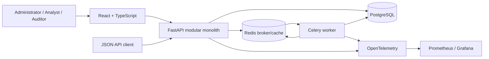

# Intended Architecture

## Architectural style

LedgerGuard begins as a modular monolith with a separate background worker process. A single FastAPI codebase owns the domain boundary and PostgreSQL transactions, while Celery executes long-running, idempotent work. This keeps deployment and consistency understandable without preventing later extraction of a measured bottleneck.

## Cohesive modules

- **Identity and access:** users, password/session lifecycle, roles, authorization policies.
- **Ingestion:** batch intake, schema validation, row outcomes, idempotency, quality summaries.
- **Ledger:** immutable source transaction and settlement facts with decimal-safe amounts.
- **Reconciliation:** run configuration, candidate matching, classifications, and evidence.
- **Fraud monitoring:** versioned deterministic rules, evaluations, alerts, and evidence.
- **Investigations:** cases, alert links, ownership, comments, and lifecycle history.
- **Reporting:** verified aggregates and formula-safe exports.
- **Audit:** append-only security and business event history.
- **Platform:** configuration, database, queues, health, telemetry, and cloud adapters.

Modules may share one deployment and database but communicate through explicit service interfaces. Domain code should not import UI, transport, or cloud-provider concerns.

## Primary data flow

1. An authorised analyst uploads a versioned CSV or submits JSON with an idempotency key.
2. The API authenticates, authorises, validates request metadata, creates or returns a batch, and enqueues work.
3. A worker validates rows, storing accepted and rejected outcomes without losing source attribution.
4. Reconciliation reads eligible immutable facts, writes a versioned run and evidence-backed classifications atomically.
5. Fraud rules evaluate stored facts and reconciliation evidence, producing versioned alerts when conditions match.
6. Analysts investigate alerts through cases; all state transitions and comments emit audit events.
7. Reports independently aggregate persisted facts and verify totals before becoming available.

## Data integrity conventions

- Money uses Python `Decimal`, JSON decimal strings, and PostgreSQL `NUMERIC(20,6)` as defined in [ADR-0001](../decisions/0001-decimal-money.md). JavaScript will not calculate money with `number`; the interface will format server-provided decimal strings or use a reviewed decimal library where calculation is unavoidable.
- Domain and correlation identifiers use opaque UUIDv4 values as defined in [ADR-0002](../decisions/0002-identifiers.md). Source identifiers remain scoped to their account/source boundary.
- Timestamps use timezone-aware UTC in Python and PostgreSQL. ISO 8601 API values carry `Z`/UTC offsets. The interface may convert to a configured display zone but must label it.
- Critical uniqueness, lifecycle, and relationship rules exist in both application validation and database constraints.
- Source records are not mutated to represent processing outcomes; outcomes and history are separately attributable.
- Application audit history is append-only under the runtime database role as defined in [ADR-0003](../decisions/0003-append-only-audit-history.md).

## Security and trust boundaries

- Browsers and API clients are untrusted. FastAPI authenticates, authorises, validates, and limits every request.
- Uploaded files and all source fields are untrusted and processed with size/type limits and safe parsing.
- Redis is coordination infrastructure, not the authoritative financial record.
- PostgreSQL is the system of record. Application and migration credentials should be distinct in production.
- Workers are trusted application processes but tasks remain safe under replay and duplicate delivery.
- Telemetry receives allowlisted metadata and correlation identifiers, never credentials or raw sensitive payloads.
- GCP-specific deployment and secret access remain under `infra/` or platform adapters rather than domain modules.

## Deployment intent

Docker Compose is the local reference environment. The intended production shape is separately deployed API, frontend, and worker containers with managed PostgreSQL, an appropriate managed Redis/queue service, injected secrets, HTTPS at the edge, and managed observability. Cloud Run suitability for long-running workers and the final queue choice will be evaluated during Day 19 rather than hidden behind an unsupported assumption.

## Planned quality gates

- Python formatting/linting: Ruff; typing tool finalized on Day 3.
- Backend and domain tests: pytest, including PostgreSQL/Redis integration tests.
- Frontend formatting/linting/types/tests: ESLint, TypeScript, and a selected unit-test runner.
- Browser journeys: Playwright for each role.
- CI: clean installation, format checks, lint, type checks, tests, and production builds.
- Security: dependency and secret scanning plus threat-model-driven tests.
- Operations: health endpoints, structured logs, metrics, traces, dashboards, and runbooks.
